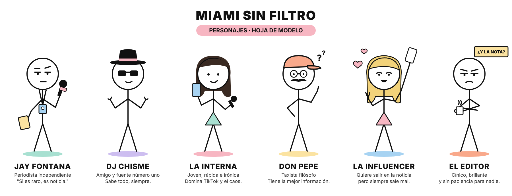

# Miami Sin Filtro: guía de estilo visual

**Nombre del estilo:** Miami Sin Filtro — Minimalist 2D Stickman Editorial Cartoon
**Acabado elegido:** digital limpio, de aspecto vectorial (ver la variante a mano al final).



`personajes.svg` es la hoja de modelo editable: abre el SVG en Figma, Illustrator o Inkscape para sacar poses nuevas.

---

## 1. Master style prompt (va en TODOS los prompts)

```
Clean minimalist 2D stickman editorial cartoon illustration, flat vector-like digital art, oversized perfectly round pure white character heads, thin uniform black outlines, simple black stick-line arms and legs, tiny dot eyes, sarcastic half-closed expressions, minimal facial features, simple geometric bodies, flat solid pastel colors, simplified tropical Miami environments, clean white backgrounds, subtle humorous visual storytelling, modern explainer animation aesthetic, crisp edges, consistent line thickness, professional minimal cartoon composition.
```

### Negative prompt (para los generadores que lo admiten)

```
gradients, realistic shading, 3D rendering, painterly effects, watercolor, paper texture, sketchy strokes, realistic faces, detailed anatomy, noses, ears, fingers, photo, text artifacts, cluttered background, dark moody lighting
```

> En los generadores sin campo negativo, deja el `no gradients, no realistic shading, no 3D rendering, no painterly effects, no watercolor, no paper texture, no sketchy strokes` al final del master prompt.

**Cómo armar un prompt:** `[ESCENA] + [PERSONAJE(S)] + [LUGAR] + MASTER STYLE PROMPT + formato`

---

## 2. Reglas fijas

| Elemento | Regla |
| --- | --- |
| Cabeza | Círculo perfecto, blanco puro, ~1/3 de la altura total del personaje |
| Contorno | Negro `#111111`, grosor uniforme, puntas redondeadas |
| Cuerpo | Una línea recta de torso; brazos y piernas son palitos sin manos ni pies dibujados |
| Ojos | Dos puntos. El tono sarcástico sale de un párpado recto encima del punto |
| Boca | Una línea: recta (seco), curva (sonrisa), invertida (fastidio) |
| Sin dibujar | Nariz, orejas, dedos, sombras, brillos, degradados |
| Color | Solo en accesorios, pelo, ropa mínima y fondos. Rellenos planos |
| Fondo | Blanco limpio o escenario de Miami con formas geométricas simples |
| Perspectiva | Casi plana, 2D, cámara a la altura del pecho |

### Paleta

| Color | Hex | Uso típico |
| --- | --- | --- |
| Tinta | `#111111` | Líneas, gafas, micrófono |
| Blanco | `#FFFFFF` | Cabezas, fondo |
| Rosa flamenco | `#F7B6C2` | Logo MSF, corazones, acentos de marca |
| Menta Ocean Drive | `#A8E0D1` | Mar, art deco, ropa |
| Cielo Miami | `#A7D3F2` | Cielo, pantallas, credenciales |
| Amarillo sol | `#FBE3A1` | Sol, libreta, carteles |
| Lavanda | `#CDBEF0` | Noche, neón suave |
| Coral | `#F9A98B` | Gorras, autos, atardecer |

---

## 3. Personajes: prompts de consistencia

Copia el bloque del personaje y añade la escena + el master prompt.

**Jay Fontana (protagonista)**
```
Jay Fontana, a stickman reporter with an oversized round white head, half-closed sarcastic eyes with flat eyelids, one eyebrow raised, flat unimpressed mouth line, black stick body, wearing a press badge on a lanyard, holding a black handheld microphone with a small pink "MSF" flag, carrying a small yellow notebook
```

**DJ Chisme**
```
DJ Chisme, a stickman with an oversized round white head, black fedora hat with a pink band, black rectangular sunglasses, small knowing smirk, shrugging with both stick arms raised, the gossip insider who knows everything
```

**La Interna**
```
La Interna, a young stickman woman with an oversized round white head, long straight dark brown hair, small dot eyes, playful smile, mint triangle skirt, holding a light blue smartphone in one hand and a mini microphone in the other, fast and ironic TikTok energy
```

**Don Pepe**
```
Don Pepe, an older stickman taxi driver with an oversized round white head, coral flat cap, round thin glasses, thick black mustache, one stick arm raised as if explaining a philosophical theory, small question marks floating near his head
```

**La Influencer**
```
La Influencer, a stickman woman with an oversized round white head, long pastel-blonde hair, flirty curved eyes, open smiling mouth, pink triangle skirt, holding a selfie stick with a phone up high, making a peace sign, small pink hearts floating around
```

**El Editor**
```
El Editor, a cynical stickman with an oversized round white head, heavy flat eyelids and angled frowning eyebrows, small frown, arms crossed, holding a steaming white coffee mug, a yellow sign above him that reads "¿Y LA NOTA?"
```

---

## 4. Lugares clave: prompts de escenario

**La Playa:** `simplified Miami beach, flat pastel sand and mint sea, one pink-and-white striped beach umbrella, two simple palm trees, flat yellow sun, clean white sky`

**Ocean Drive:** `simplified Ocean Drive street, flat pastel art deco buildings in mint, pink and lavender, rounded neon signs without readable text, simple palm trees, a couple of flat coral and yellow classic cars`

**Little Havana:** `simplified Little Havana corner, flat pastel storefronts, a ventanita coffee window, domino table under a palm tree, rooster silhouette, warm yellow and coral tones`

**Wynwood:** `simplified Wynwood street, flat pastel walls with geometric graffiti murals in bold flat shapes, warehouse doors, a food truck`

**El Tráfico:** `simplified Miami highway traffic jam, rows of flat pastel cars, tiny city skyline in the background, palm trees on the median, cars honking shown with simple black lines`

**Base de operaciones (estudio MSF):** `small cluttered news studio in Wynwood, simple wooden desk, black office chair, red "ON AIR" sign, "MSF NEWS" monitor, potted plant, big window with palm trees, coffee mug that says "CAFÉ + CAOS"`

---

## 5. Plantillas de escena por sección del programa

**Portada / thumbnail**
```
Jay Fontana standing in the center holding his microphone toward the viewer with a deadpan expression, behind him a simplified pastel Miami skyline with palm trees, bold empty space at the top for a headline, [MASTER STYLE PROMPT], 16:9 thumbnail composition
```

**"Solo en Miami"**
```
Jay Fontana reporting with a deadpan face while in the background [ABSURD MIAMI SITUATION, e.g. a flamingo directing traffic on Ocean Drive], other stickman pedestrians acting completely normal, [MASTER STYLE PROMPT], vertical 9:16
```

**"Gente que no lo podía creer"**
```
Jay Fontana interviewing a shocked stickman with wide dot eyes and an open mouth, both standing on [LOCATION], small exclamation marks floating around, [MASTER STYLE PROMPT], vertical 9:16
```

**"Alerta WTF"**
```
Jay Fontana at the MSF news desk under a flashing flat red "WTF?!" sign, holding a paper headline, sarcastic half-closed eyes looking straight at the camera, [MASTER STYLE PROMPT], vertical 9:16
```

**Cierre (frase icónica)**
```
Jay Fontana walking away into a flat pastel Miami sunset, microphone over his shoulder, palm trees silhouetted in flat coral and lavender, empty space for the closing line, [MASTER STYLE PROMPT]
```

---

## 6. Variante "a mano" (opcional)

Para que se parezca más a la ficha original, que tiene un ligero aspecto de dibujo a mano, cambia el final del master prompt:

- **Quita:** `crisp edges, consistent line thickness`, y saca `paper texture, sketchy strokes` del negative prompt.
- **Añade:** `hand-drawn doodle feel, slightly wobbly ink lines, subtle off-white paper background, marker-like flat color fills`

Elige una de las dos versiones y úsala en toda la serie. Si las mezclas, la serie pierde consistencia.

---

## 7. Checklist antes de publicar una imagen

- [ ] ¿Cabeza blanca perfectamente redonda y sin nariz ni orejas?
- [ ] ¿Ojos de punto con párpado recto (Jay siempre medio dormido / irónico)?
- [ ] ¿Sin degradados, sombras ni texturas?
- [ ] ¿Colores solo de la paleta?
- [ ] ¿El accesorio clave del personaje está visible (micro MSF, fedora, gorra, selfie stick, café)?
- [ ] ¿El chiste se entiende sin leer texto?
