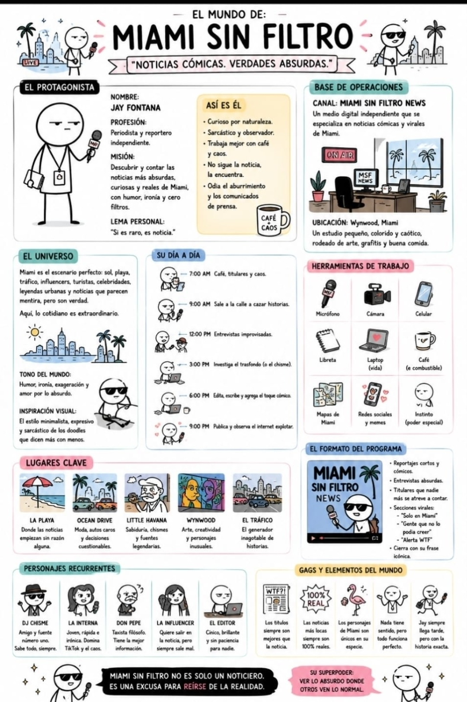

# Miami Sin Filtro: guía de estilo

> **La regla número uno: la ficha original manda.**
> `referencia/ficha-original.jpg` es la fuente de verdad del estilo y del mundo. Si algo de esta guía contradice la ficha, gana la ficha.



## La esencia en una frase

**Doodles minimalistas, expresivos y sarcásticos que dicen más con menos:** muñecos de cabeza blanca enorme dibujados a mano con tinta negra, sobre papel crema, con toques pastel de marcador.

---

## 1. Cómo se ve (tomado de la ficha)

| Elemento | Cómo es en la ficha |
| --- | --- |
| Trazo | Tinta negra **a mano**, con un ligero temblor. No es vectorial perfecto: los círculos casi cierran |
| Fondo | Papel crema / blanco cálido, con recuadros redondeados de contorno suave |
| Cabeza | Muy grande, blanca y redonda (algo ovalada), sin nariz ni orejas |
| Cuerpo | Torso con **contorno de camisa o saco** (no es un palito), relleno blanco o de un color |
| Brazos y piernas | Un solo trazo fino, **manos redondas pequeñas**, pies como óvalos negros |
| Ojos de Jay | **Párpado pesado:** una línea recta tapa medio ojo y la pupila cuelga debajo. Cejas cortas, una levemente arqueada |
| Boca | Una línea corta y plana. Jay casi nunca sonríe |
| Color | Pastel de marcador: rosa, menta, amarillo, azul cielo, coral, lavanda. Plano, sin brillos |
| Pelo | Gris oscuro con mechones de lápiz |
| Textos | Letra a mano en mayúsculas para títulos y letra de imprenta a mano para notas |
| Rótulos | Etiquetas de color como cinta adhesiva (EL PROTAGONISTA, LUGARES CLAVE…) |
| Detalles | Corazones, signos "?", destellos ✦, rayitas de movimiento, vapor de café |

### Paleta

| Color | Hex | Uso en la ficha |
| --- | --- | --- |
| Tinta | `#1E1E1E` | Todo el contorno, gafas, micro, fedora |
| Papel | `#FBF7EF` | Fondo |
| Rosa | `#F2A7B5` | Títulos de sección, corazones, flamenco |
| Menta | `#9ED6CB` | Mar, palmeras, art deco |
| Amarillo | `#F7DC8C` | "Así es él", sol, carteles |
| Azul cielo | `#A9CDEB` | Pantallas, cielo, "Su día a día" |
| Coral | `#F4A483` | Autos, atardecer |
| Lavanda | `#C9BCEB` | Edificios, noche |
| Rojo MSF | `#E0646A` | Etiqueta MSF del micrófono, "ON AIR" |

---

## 2. Prompt maestro para generadores de imágenes

```
Hand-drawn minimalist doodle illustration in the style of a sarcastic comic world-bible sheet: stick-figure characters with oversized round white heads, heavy half-closed eyelids with small hanging pupils, short flat mouth line, simple outlined shirt-shaped bodies, thin single-line arms and legs with small round hands, slightly wobbly black ink lines, soft flat pastel marker colors (pink, mint, butter yellow, sky blue, coral, lavender), warm cream paper background, simplified tropical Miami scenery with palm trees and pastel art deco buildings, handwritten lettering, minimalist, expressive, says more with less, deadpan humor
```

### Lo que no debe aparecer

```
3D, realistic shading, gradients, glossy vector, photorealism, detailed anatomy, noses, ears, fingers, anime, thick cartoon outlines, dark background, cluttered composition
```

**Fórmula:** `[ESCENA] + [PERSONAJE] + [LUGAR] + PROMPT MAESTRO`

---

## 3. Personajes (prompts de consistencia)

**Jay Fontana:** `Jay Fontana, deadpan stickman reporter, oversized round white head, heavy half-closed eyelids, one eyebrow slightly raised, short flat mouth, white shirt-shaped body, press badge on a lanyard, black handheld microphone with a red "MSF" label, small notebook under his arm`

**Jay en modo ON AIR:** `same Jay Fontana wearing black rectangular sunglasses and a tiny smirk, holding the MSF microphone toward the camera`

**DJ Chisme:** `DJ Chisme, stickman with black fedora with a pink band, black sunglasses, dark shirt, knowing smirk, both hands raised in a shrug`

**La Interna:** `La Interna, young stickman woman, long dark wavy hair drawn in pencil, dot eyes, big smile, mint striped shirt, phone in one hand and a microphone in the other`

**Don Pepe:** `Don Pepe, older stickman taxi driver, bald with tufts of white hair, round glasses, big grey mustache, hand on chin, floating question marks`

**La Influencer:** `La Influencer, stickman woman with long dark hair, happy closed eyes, open smile, pink shirt, selfie phone held high, peace sign, little pink hearts floating around`

**El Editor:** `El Editor, grumpy stickman with heavy eyelids and angry eyebrows, frown, blue shirt, working at a laptop or holding a coffee, zero patience`

---

## 4. Láminas generadas

Están en `laminas/` y se regeneran con `python3 herramientas/generar.py`:

| Lámina | Contenido |
| --- | --- |
| `01-personajes` | Hoja de modelo de los 6 personajes |
| `02-jay-modos` | Jay en modo Calle, On Air y Estudio |
| `03-ep01-portada` | Portada del Episodio 01: "Un flamenco dirige el tráfico en Ocean Drive" |

`herramientas/dibujo.py` es el motor de trazo a mano: cada personaje es una función (`jay()`, `dj_chisme()`, `don_pepe()`…), igual que la escenografía (`palmera()`, `auto()`, `flamenco()`, `edificio_deco()`). Para una escena nueva, se combinan esas piezas.

---

## 5. Checklist antes de publicar

- [ ] ¿Se ve hecho a mano, en papel crema, como la ficha?
- [ ] ¿Cabeza blanca grande y sin nariz ni orejas?
- [ ] ¿Jay tiene el párpado pesado y la boca plana (salvo en modo ON AIR)?
- [ ] ¿Cada personaje lleva su accesorio clave? (micro MSF, fedora, gorra, selfie, café)
- [ ] ¿Colores solo de la paleta pastel?
- [ ] ¿El chiste se entiende con un vistazo?
